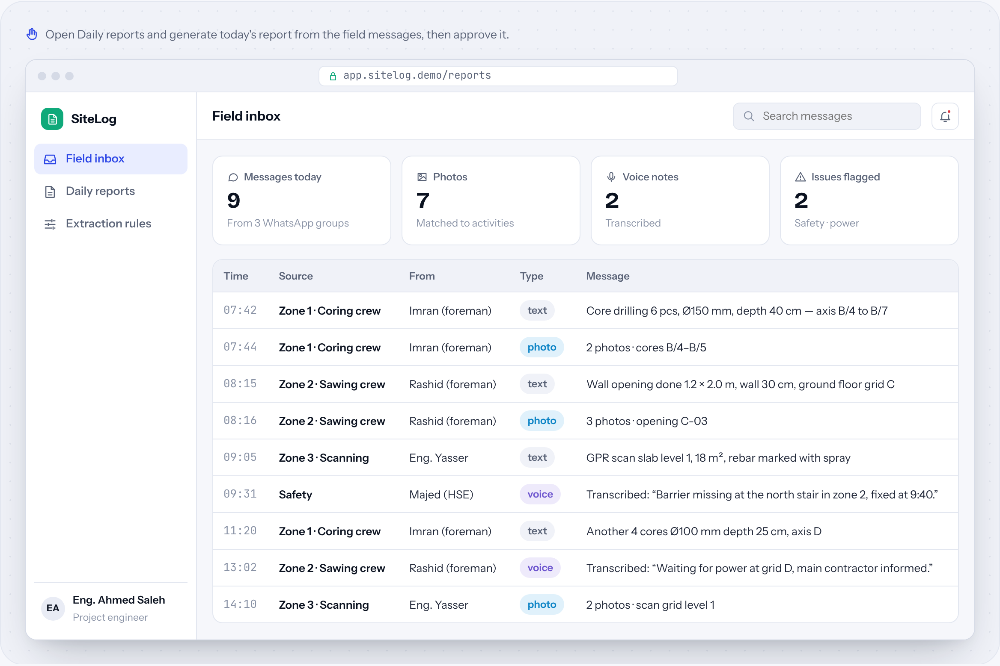
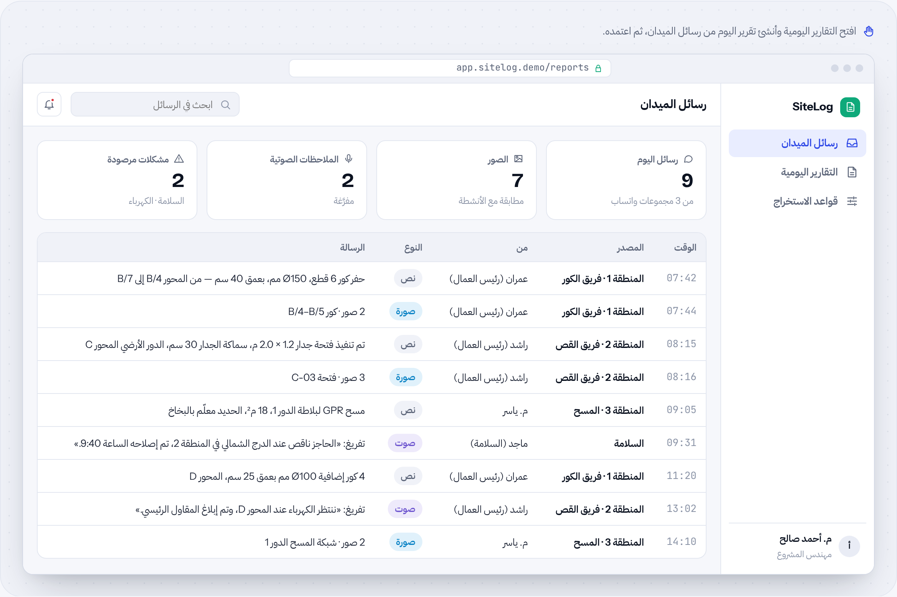

# SiteLog

**Field messages → daily reports** · AI automation · by [HUDERA AI](https://www.linkedin.com/company/hudera)

Turns the messages, photos and voice notes your field teams already send into a clean daily report in your template, ready for review.

**[▶ Try the live demo](https://hudera-ai.github.io/sitelog/)** · runs in your browser on sample data · Arabic & English

## The problem
Supervisors send updates as WhatsApp messages and photos all day. Someone then spends hours each evening rebuilding them into a report for management or the client.

## What it does
SiteLog reads the field groups, transcribes voice notes, extracts each activity with quantities and units using rules you agree with the team, matches photos, and builds the report as a PDF for an engineer to approve.

## Business value
The report is ready when the day ends, in the same format every time, and the person who used to compile it reviews instead of retyping.

## Features
| Feature | Details |
| --- | --- |
| Reads field groups | Text, photos and voice notes |
| Voice transcription | Arabic and English |
| Project rules | Units and wording your client expects |
| Photo matching | Photos placed under the right activity |
| Your template | PDF or Excel in your existing format |
| Review step | Nothing is sent before approval |

## How the workflow runs
**Trigger**: End of shift → **Collect**: Messages & media → **Extract**: Activities & quantities → **Build**: Report PDF → **Approve**: Engineer review

## Typical stack
WhatsApp · Speech-to-text · LLM extraction · Python PDF engine · Web app

## Run it locally
Open `index.html` in any modern browser. No build step, no server, no data leaves your machine.

---

## SiteLog بالعربي

**رسائل الميدان ← تقارير يومية**

يحوّل الرسائل والصور والملاحظات الصوتية التي ترسلها فرقك الميدانية إلى تقرير يومي منظم بقالبك، جاهز للمراجعة.

### المشكلة
المشرفون يرسلون التحديثات رسائل وصوراً على واتساب طوال اليوم، ثم يقضي أحدهم ساعات كل مساء في تجميعها في تقرير للإدارة أو العميل.

### ما الذي يفعله
يقرأ SiteLog مجموعات الميدان، ويفرّغ الملاحظات الصوتية، ويستخرج كل نشاط بكمياته ووحداته وفق قواعد تتفق عليها مع الفريق، ويطابق الصور، ثم يبني التقرير PDF ليعتمده المهندس.

### القيمة للأعمال
التقرير جاهز مع نهاية اليوم وبنفس الشكل كل مرة، ومن كان يجمعه يدوياً أصبح يراجعه فقط.

### المزايا
| الميزة | التفاصيل |
| --- | --- |
| يقرأ مجموعات الميدان | نصوص وصور وملاحظات صوتية |
| تفريغ الصوت | عربي وإنجليزي |
| قواعد المشروع | الوحدات والصياغة التي يتوقعها عميلك |
| مطابقة الصور | كل صورة تحت النشاط الصحيح |
| قالبك | PDF أو Excel بنفس شكلك الحالي |
| خطوة مراجعة | لا يُرسل شيء قبل الاعتماد |

### كيف يسير العمل
**المُشغِّل**: نهاية الوردية ← **Collect**: الرسائل والوسائط ← **الاستخراج**: الأنشطة والكميات ← **Build**: تقرير PDF ← **اعتماد**: مراجعة المهندس

---

## About HUDERA AI
HUDERA AI builds WhatsApp AI assistants, business dashboards, workflow automations and custom SaaS products for companies in Saudi Arabia and the Gulf.

- LinkedIn: [linkedin.com/company/hudera](https://www.linkedin.com/company/hudera)
- Email: hudera.ai@gmail.com
- WhatsApp: [+20 155 515 9139](https://wa.me/201555159139)

> This repository is a product demo. Company names, people and figures inside it are fictional sample data.

© 2026 HUDERA AI. All rights reserved.
