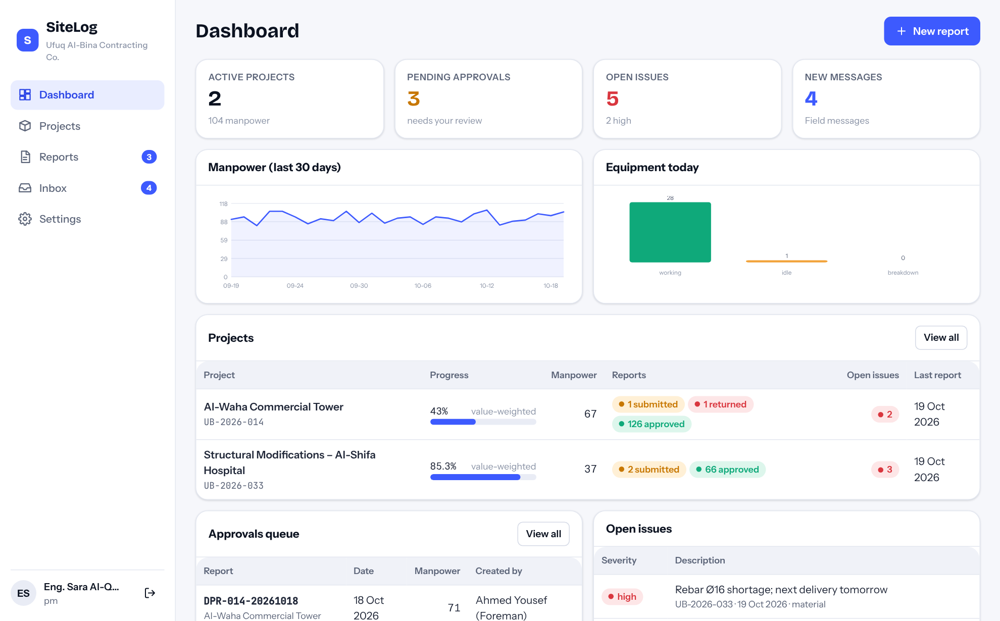
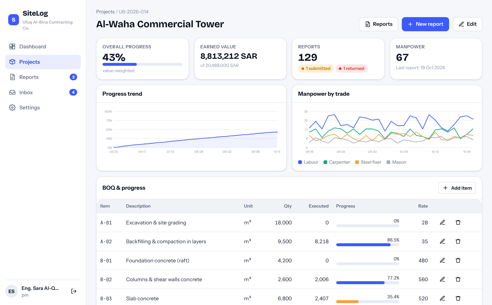
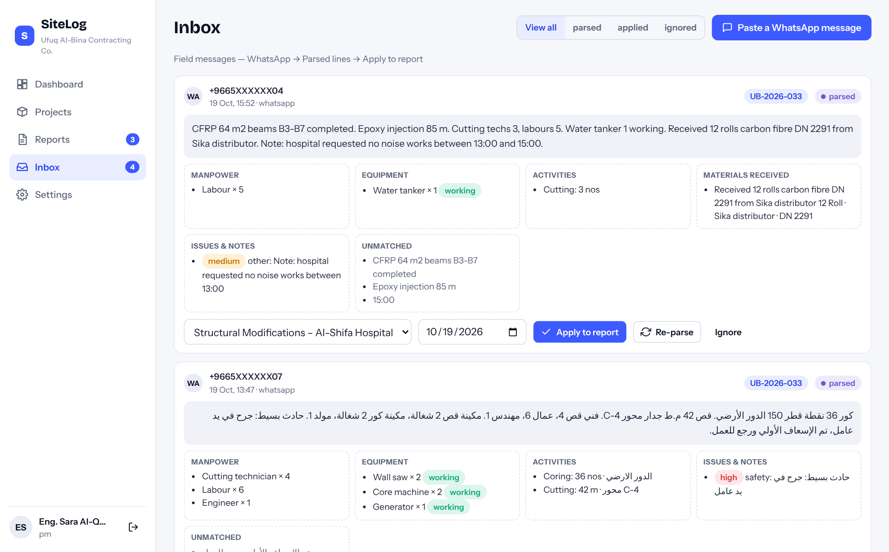
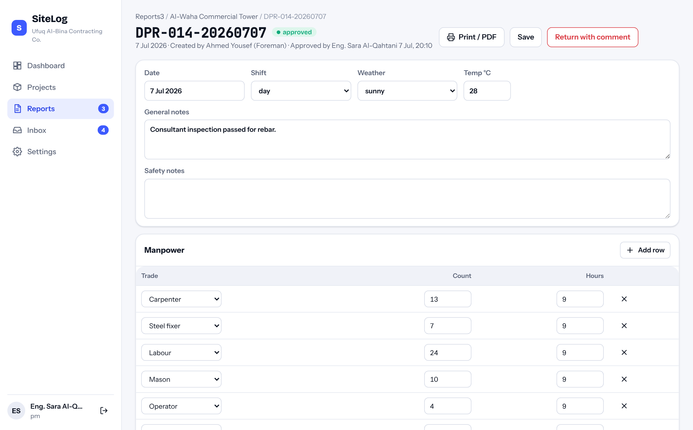
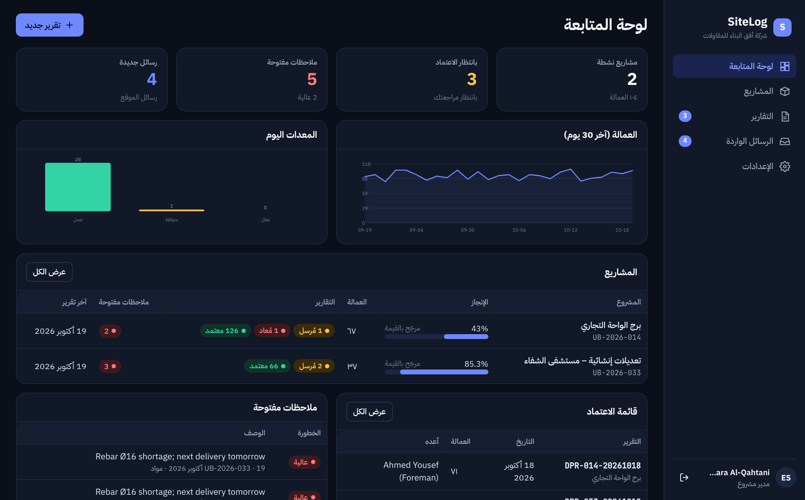
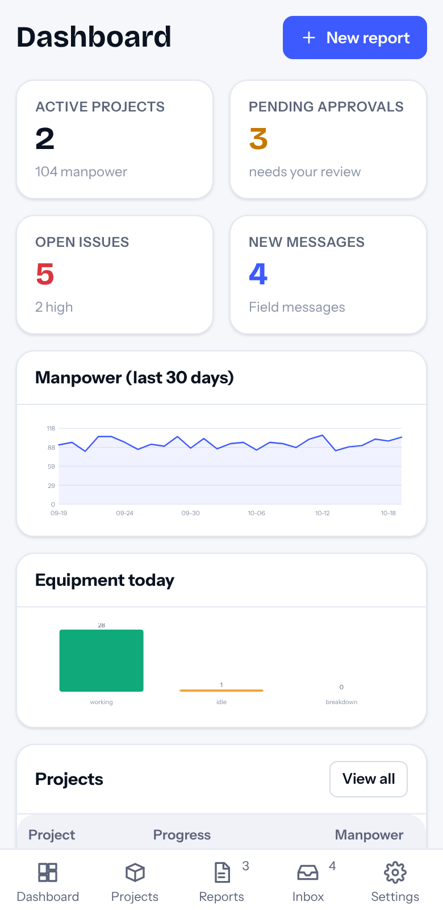

<p align="center">
  
</p>
<h1 align="center">SiteLog</h1>
<p align="center"><b>Daily site reporting for contractors</b> — field messages → structured daily reports → approvals → BOQ progress.<br>
<a href="https://hudera-ai.github.io/sitelog/">Live demo</a> · <a href="#arabic">العربية</a> · built by <a href="https://hudera-ai.github.io">HUDERA AI</a></p>

<p align="center"></p>

A complete, working system — not a mock-up. The same code runs in two ways:

| | How | Data |
|---|---|---|
| **Live demo** (GitHub Pages) | The web app runs SQLite inside your browser (sql.js / WebAssembly). | Sample dataset, stored in your browser only. Reset it from *Settings*. |
| **Self-hosted** | `npm start` → Node server with a REST API, sessions and a WhatsApp webhook, serving the same web app. | SQLite file in `data/`. |

> Sample data: the company (*Ufuq Al-Bina Contracting Co.*), its people, projects and figures are fictional and exist only to demonstrate the product.

## What it does

- **Field messages → report lines.** Paste (or receive via the WhatsApp webhook) a foreman's message in Arabic, English or a mix. The parser extracts manpower by trade, equipment with working/idle/breakdown status, activities with quantities and units, materials received with delivery-note numbers, and issues with type and severity. One click applies the lines to that day's report, and activities are matched to BOQ items automatically.
- **Daily reports** with manpower, activities, equipment, materials, issues and photos; weather and shift; general and safety notes.
- **Approval workflow:** foreman/engineer drafts and submits → project manager approves or returns with a comment → locked once approved. Every action is written to an audit log.
- **BOQ progress** per item (executed vs. quantity) and a value-weighted overall progress and earned value per project, plus manpower and progress trends.
- **Printable report** (A4) with company header and signature blocks — use *Print / PDF*.
- **Roles & scoping:** admin, project manager, engineer, foreman, client viewer. Users only see the projects they belong to.
- **Arabic / English UI**, RTL layout, light and dark themes, responsive down to phone size.
- **Optional LLM parsing:** set `LLM_API_KEY` and the server asks an OpenAI-compatible model to extract the lines; the rule-based parser remains the fallback and validator.

## Run it locally

```bash
git clone https://github.com/hudera-ai/sitelog.git
cd sitelog
npm install
npm start            # → http://localhost:8787
```

Sign in with any demo user, password `demo1234`:

| Email | Role |
|---|---|
| khalid@ufuq.example | admin |
| sara@ufuq.example | project manager |
| mahmoud@ufuq.example | engineer |
| ahmed@ufuq.example | foreman |
| viewer@ufuq.example | client viewer (read-only) |

Other commands: `npm run seed` resets the database to the sample data · `npm test` runs the test suite (parser + workflow) · `npm run dev` restarts on file changes.

## Architecture

```
sitelog/
├── index.html, src/, assets/     web app (vanilla ES modules, no build step)
│   └── src/api.js                one client interface, two transports: HTTP or in-browser SQLite
├── shared/                       code used by BOTH the server and the browser demo
│   ├── service.js                every operation (auth, projects, reports, inbox, dashboard)
│   ├── parser.js                 field-message parser (AR/EN) + BOQ matching
│   ├── seed.js                   deterministic sample dataset
│   └── auth.js, dbx.js           PBKDF2 passwords (Web Crypto), SQL helper
├── server/src/                   Express API, sessions, WhatsApp webhook, optional LLM parsing
├── db/schema.sql                 SQLite schema (14 tables)
├── tests/                        node:test suites
└── docs/                         screenshots, API reference
```

The domain logic lives once in `shared/service.js` and is exercised identically by the REST layer and by the browser demo, so what you click in the demo is exactly what the server does.

### REST API (summary)

`POST /api/auth/login` · `GET /api/projects` · `GET /api/projects/:id` (BOQ + progress) · `GET|POST|PATCH /api/reports` · `POST /api/reports/:id/submit|approve|return` · `GET|POST /api/inbox` · `POST /api/inbox/:id/apply` · `POST /api/parse` · `GET /api/dashboard` · `GET /api/audit` · `GET|POST /webhook/whatsapp` (Meta Cloud API). Full reference in [docs/API.md](docs/API.md).

## Screenshots

| Project page (BOQ & progress) | Inbox (message → lines) |
|---|---|
|  |  |

| Report | Arabic, dark theme | Mobile |
|---|---|---|
|  |  |  |

## Production notes

This repository is a product demo that is deliberately dependency-light (Express + sql.js). For a client deployment HUDERA AI typically adds: PostgreSQL instead of SQLite, persistent sessions, object storage for photos, the WhatsApp Business API connection, scheduled PDF e-mails, and the client's own report template.

---

<a id="arabic"></a>
## SiteLog بالعربية

**نظام التقارير اليومية لمواقع المقاولات** — رسائل الموقع ← تقرير يومي منظم ← اعتماد ← نسبة إنجاز من جدول الكميات.

- **من رسالة واتساب إلى سطور التقرير:** الفورمان يبعت رسالة بالعربي أو الإنجليزي (مثل: «12 نجار، 8 حداد، تم صب 35 م3 سقف الدور الثاني، لودر 1 عطلان، وصل 200 كيس أسمنت»)، النظام يستخرج العمالة والمعدات والأعمال والمواد والملاحظات، ويضيفها لتقرير اليوم بضغطة واحدة، ويربط الأعمال ببنود جدول الكميات تلقائيًا.
- **تقرير يومي كامل:** عمالة، أعمال منفذة، معدات، مواد مستلمة، ملاحظات ومشاكل، طقس ووردية.
- **دورة اعتماد:** الفورمان يرسل ← مدير المشروع يعتمد أو يعيد بتعليق ← التقرير يُقفل بعد الاعتماد، مع سجل عمليات كامل.
- **الإنجاز:** نسبة تنفيذ كل بند، وإنجاز كلي مرجّح بالقيمة، وقيمة منجزة لكل مشروع.
- **طباعة A4** بترويسة الشركة وخانات التوقيع.
- **صلاحيات:** مدير نظام، مدير مشروع، مهندس، فورمان، مشاهد للعميل — كل مستخدم يرى مشاريعه فقط.
- **عربي/إنجليزي** مع اتجاه RTL، مظهر فاتح وداكن، ويعمل على الموبايل.

> البيانات تجريبية: الشركة (أفق البناء للمقاولات) والأشخاص والمشاريع والأرقام كلها افتراضية لغرض العرض فقط.

**التشغيل:** `npm install` ثم `npm start` ويفتح على `http://localhost:8787` — كلمة مرور كل المستخدمين التجريبيين `demo1234`.

---
© 2026 HUDERA AI · AI automation & SaaS products for businesses in Saudi Arabia and the Gulf · [hudera-ai.github.io](https://hudera-ai.github.io)
